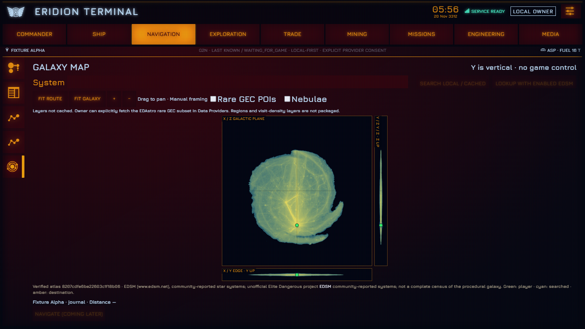
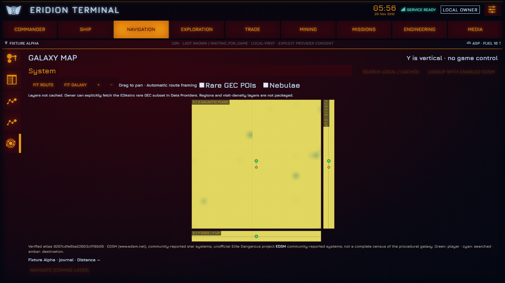

# G2O — signed Galaxy Atlas client

Stacked on G2N `264eea7bdc195ce62a60d13f00c62517f132e5ad`;
branch `go/g2o-signed-galaxy-atlas-client`. The draft PR description is the final
exact-head CI/artifact/checksum ledger, completed after CI without a documentation-only rebuild.
PR #20 and all earlier branches remain unchanged.

## Contract and implementation

Read all six required publisher files on `feat/monthly-atlas-staging-publisher`,
resolved at `9ff8189732954a7a2c847dc0852588ad38b01524` in
[Galaxy Painter](https://github.com/Jakoczig/Eridion-Galaxy-Painter/tree/9ff8189732954a7a2c847dc0852588ad38b01524).
`production_publisher.py` blob `b17c2c81b0558c661d8a5ed0e452bb13ab255e5f`
defines signed-v2; `atlas.py` defines dimensions, bit order and orientation.
No publisher/server/generator changes or Proxmox access were performed.

| Area | Implementation |
|---|---|
| Trust | Raw Ed25519 key `02003dd1d8c65f28c103eb0d7e3513bb36f6c82cb35208da7606005d1c4f4cdb` pinned in Go. HTTPS PEM fingerprint matched supplied operator ID `d679ccea38ac5d02`. Runtime never downloads/trusts a PEM or rotates keys. |
| Protocol | Python-compatible canonical payload bytes (including Unicode, exact integers and float formatting), signature/key/algorithm checks, recursive duplicate rejection, surrogate/numeric/depth/size validation, exact schemas and paths, pointer time/high-water checks, immutable IDs and hashes. Release IDs are hashes, not sortable version numbers. |
| Network | Fixed HTTPS origin; no cookies, credentials, queries or arbitrary URL proxy; strict redirects, header/body bounds, 8s pointer and 30s asset deadlines. No requests on ordinary startup unless opted in. Automatic pointer attempts, including failure, persist a 24h cooldown and conditional ETag. No busy polling, automatic installs or source-dump downloads. |
| Install | Signed pointer/index → bounded overview → validated CRC/PNG/occupancy metadata in isolated staging → immutable version directory → atomic active-state write. Previous release retained; explicit verified rollback. Failed extraction/write/download cannot replace the old release. Abandoned staging is cleaned on restart. |
| Detail | Metadata-driven LOD and sparse visible tiles, catalog hashes/identity/counts, <=2 workers, cancellation on superseding viewport, fairness across projections, verified lower-LOD fallback. Persistent 128 MiB LRU detail target with the bounded visible-working-set exception below, bounded catalogs/metadata, memory-only access tracking. No raster generation. |
| UI | Original three-plane layout, shared pan/zoom/Fit actions and overlays preserved. Verified cropped tile references replace illustrative native imagery. Launcher/settings expose version, provenance, checks, progress, separate permissions, cache cleanup, rollback and errors. No atlas means an honest uninstalled state. |
| Security | Existing single Go service and profile lock; read-only authenticated asset routes; viewers cannot mutate settings/install/fetch remotely. SQLite, commander isolation, Frontier and uploads untouched. |

Bounds: 64 MiB ZIP, 128 MiB total extraction, 2,000 overview entries, 4 MiB metadata/PNG,
12 MiB/catalog, nine detail catalogs, 30,000 detail descriptors, 32 JSON nesting levels,
96 visible tiles per projection. Active and previous releases remain separate. Catalogs
and overview storage are additional to the 128 MiB detail budget. Images are verified
against signed metadata before serving. Manual checks provide retry; automatic pointer
failures cool down for 24h, and failed detail attempts retry after a changed viewport
or explicit permission refresh rather than looping offline.

## P2 automatic-eviction correction

Review [7042800660](https://github.com/Jakoczig/eridion/pull/22#issuecomment-7042800660),
against `14eb8a93a70da3d5279b20a21bbb1ff6f0436796`, was reproduced with a
near-full cache: inserting a signed L7 tile made the old L5 fallback unreadable
through `Manager.Asset()`. Automatic LRU now skips a cache-locked snapshot of
current source and pending paths, including verified fallback sources. Snapshot
selection/publication and eviction are serialized; no `cacheMu → mu` acquisition
is introduced. Catalog metadata is loaded outside both locks; the only nested
order is `mu → cacheMu`. Manual cleanup uses the same snapshot protection.

The 128 MiB detail target is unchanged. If the pinned working set alone exceeds
it, the effective budget is **max(128 MiB, currently pinned bytes)**; all extra
nonvisible entries are evicted. This is not a reserved allocation. A viewport
has at most 96 tiles per projection, three projections, and one displayed
fallback per desired tile: at most 576 protected paths × 4 MiB = **2.25 GiB
worst-case disk working set**. Actual retained bytes/effective budget are exposed
in owner settings. Pins refresh even on the same viewport when L7 replaces a
fallback; panning or changing release releases old pins and immediately resumes
normal budget enforcement. Historic viewports are not accumulated. Overview and
catalog storage remain additional to the detail target, as before.

Focused regressions use genuine signed fixtures for visible/incoming `Asset()`
checks and sparse cold files for near-full disk accounting. They cover automatic
insertion and rescans, LRU ordering, same-viewport refinement, pan/release,
140 MiB working-set disclosure and return to 128 MiB, unchanged manual cleanup,
and two concurrent downloads with a viewport change. A channel-controlled write
boundary proves eviction completes while `mu` is held, catching reverse lock
acquisition without relying on sleeps. Focused race tests passed; the final PR
ledger records the corrected implementation commit, comprehensive exact-head CI
and independently verified refreshed previews. Prior live publisher evidence
below is retained; this correction makes no additional production-provider calls.

## Evidence and measurements

Failing-first focused tests introduced the verifier, installer, owner asset boundary
and UI; deterministic Python golden vectors and synthetic signed-v2 archive/catalog
fixtures were generated with the actual publisher's `canonical`/`signed` functions.
Their publicly known deterministic seed is test-only, never the publisher private key.
Python is not a runtime/test dependency; Go consumes committed fixtures.

Coverage includes signature/key/expiry/schema/hash failures; malformed JSON/duplicates;
path/redirect rejection; ZIP traversal, symlinks, duplicates, bombs/truncation; PNG size;
injected ENOSPC and last-good preservation; offline restart; daily/disabled/metered/304
checks; immutable collision and rollback; sparse selection, cache restart/bounds,
cancellation/two workers; viewer controls and authenticated assets. Existing regression
gates remain mandatory. New browser checks cover 1366×768 and 680×580 geometry/uninstalled
state/settings, with external browser requests blocked. Final Windows/Linux native,
Go/JS/security/race results and checksums are recorded in the PR ledger.

Live read-only acceptance on Windows used public release `8207cdfe6be22603c1f18b06`.
Pointer and index signatures, overview hash/bytes and real L7 tile hashes were verified.
The overview is 14,545,920 bytes, 233 ZIP entries. Source states 99,738,916 accepted
community systems and independent freshness verification; upstream signed source checksum
is explicitly false. EDSM redistribution rights are operator-attested, not independently
inspected by this client implementation.

Local Go sample: overview discovery/download/validation/install **3,366 ms**;
offline verified reload **439 ms**; 1,000-LY XYZ viewport, 1,024 requested pixels:
**12 L7 tiles**, **2,020,125 bytes including three catalogs**, versus 254,133,263 bytes
for all optional detail (~0.80%). Cache occupied 31,086,367 bytes including overview
archive/extracted files/catalogs/detail. A deliberately interrupted real overview read
preserved the installed map and all previously fetched tiles. These are single samples,
not a statistical speedup or whole-native RAM/CPU claim. CI also benchmarks synthetic
cached startup with allocation accounting.

Live Chromium against the real Go fixture host displayed verified overview and L7
images in all three views at both viewports; zero browser errors/external browser calls.
The backend performed only explicit approved atlas GETs. Gameplay overlays in these
screenshots are synthetic. The two screenshot files alongside this handoff compare
real overview and detail; compact/layout evidence is also in CI artifacts. Browser
example used 1,558,460 additional bytes and reused them on the compact revisit.

## Remaining acceptance

[Preview instructions and consolidated checklist](../testing/g2o-signed-atlas-preview.md).
Physical Windows gameplay/FSD, a paired laptop and physical Linux/Proton acceptance
remain manual. CI native smoke uses Windows WebView2/Linux WebKit and synthetic data.
Public endpoints were available and live verified; a future release/key change remains
an operator acceptance gate. Key rotation requires a deliberate client build. No
generation timestamp is present in current metadata; source download time and generation
method are shown honestly. Paired browsers consume already cached details; the owner
authorizes/populates network detail. No physical gameplay claim follows from fixtures.

No merge, release, deployment, upload enablement, Frontier reauthorization, legacy
replacement or G2M-D work was performed.

