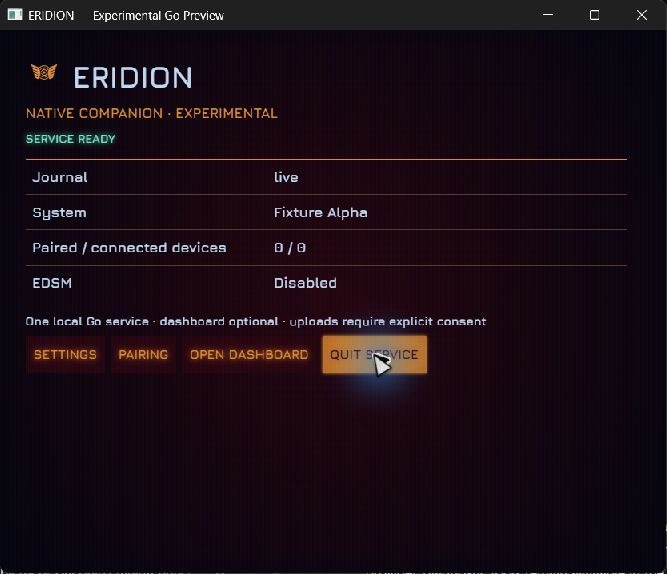
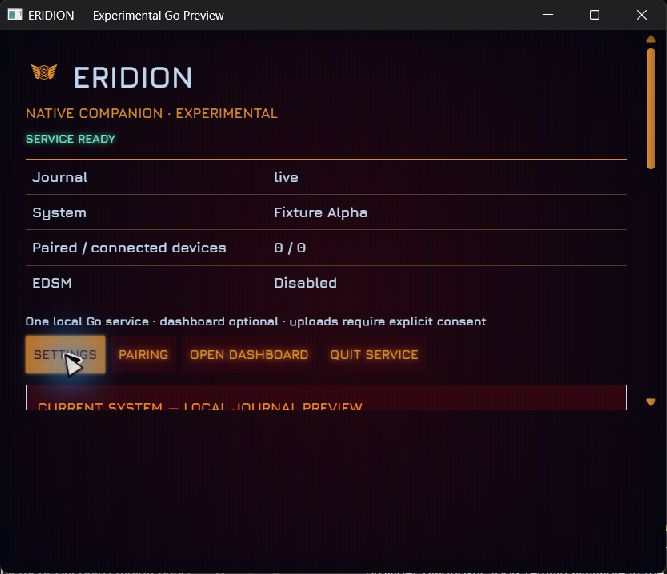
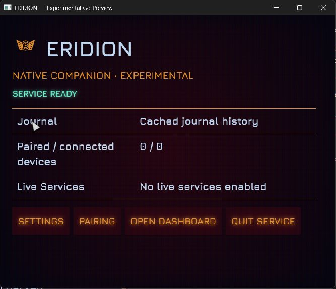
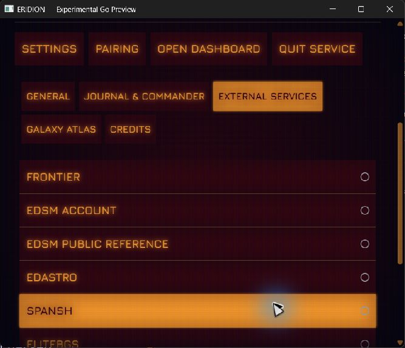

# G2P launcher, settings and Frontier prerequisites

## Targeted review correction (7050637253)

Credential controls now follow persisted credentials and consent: missing keys open
automatically after Read consent or pending Write setup; saved keys show Delete only,
including when consent is paused. Successful deletion clears pending setup and exposes
explicit re-entry. Failed persistence retains the saved state. Write setup is labeled
pending and its checkbox stays off until categories are saved; removing the last
category persists upload=false and clears staging. Account changes close the old editor.
Focused transitions assert saved configuration, rendered toggles, missing/stored/paused
credentials, deletion/re-entry and cross-account reopening.

Startup progress now says “Reviewing enabled services” and “saved status only”. Its
timer and local getGoProviders operation are unchanged; tests advance the timer
deterministically, retain the honest “not checked” result and assert no provider calls.
The PR ledger contains the correction SHA, final exact-head CI and refreshed hashes.
No Go, OAuth, vault, Atlas, portrait or production-permission change was required.

Base: G2O `dc93468d0aa88587b4a85bfb7b01dc41eadc095d`.
Branch: `go/g2p-launcher-settings-frontier`; draft stacked PR targets G2O.
Final exact-head CI, preview links and independently verified checksums are recorded
in the PR description after CI, avoiding a documentation-only rebuild.

Implemented compact launcher with five single-open settings categories, readable
journal status and one-time local provider-state inspection. Ordinary provider
success/failure updates reuse the existing owner-only WebSocket telemetry tick;
there are no startup HTTP probes, token refreshes or dummy uploads. Historical
success is not labeled a successful current check. Unverifiable services remain grey.

Clipping reproduced in the real Windows WebView2 launcher: legacy `html` zoom was
0.8/0.7 while the viewport-height scrollport was correspondingly scaled down.
Overriding only body zoom was insufficient. Launcher-only root zoom now equals 1;
the failing 826×706 test measured 564.8px instead of 706px, then passed at 706px.
Chromium checks cover 826×706, 1366×768, 680×580 and 125% emulated display scaling,
all categories, focus/scrolling, single-profile visibility and no external requests.
The original dashboard zoom and legacy application remain unchanged.

## Frontier finding

`Observe(Shutdown)` intentionally clears the live provider FID. `BeginAuthorization`
previously required it to equal the selected persisted namespace, rejecting explicit
sign-in after game shutdown despite a verified local profile. Authorization now
permits that selected persisted profile when no different live identity or pending
selection exists. It does not restore live attribution or grant account reads/uploads.
The new failing-then-passing fixture covers shutdown, authorization without network,
continued rejection of unverified account reads and pending-profile rejection.
Existing PKCE, callback validation, expiry, consent generation, account-switch and
vault tests remain intact. No callback registration or public client ID was changed.
Live owner sign-in was not performed; follow the exact preview acceptance procedure.

## Capability / consent matrix

| Service | Read | Write | Credential / gate |
|---|---|---|---|
| Frontier | Official account references | None | System-browser PKCE; verified selected profile and Read consent |
| EDSM account | Flight log | Selected live categories | Personal key + commander in OS vault |
| EDSM public reference | Public system/station references | None | No personal key |
| EDAstro | Public references / GEC | Selected biology/carrier categories | No invented personal key |
| Spansh, EliteBGS, Canonn, Raven | Existing documented reference reads | None | No invented writes or credentials |
| EDDN | None | Selected supported live categories | No personal key |
| Inara | Approval-gated | Approval-gated | Inactive pending approval |

Read confirmation persists immediately; decline/failure retains the old checkbox.
Write confirmation stages intent; no upload permission is saved until categories
and required credentials are present. Removal pauses/cancels existing provider work.
No credential is read from the vault into browser state. Native portrait selection
uses a bounded file dialog requiring launcher focus; arbitrary browser image uploads
are rejected, and target profiles must belong to verified owner history.

Atlas disabling retains verified files and stops automatic/detail activity. Confirmed
clear cancels atlas work and removes only generated atlas data, retaining profile data
and signed-pointer high-water state. The signed verifier, rollback and G2O working-set
cache policy remain in place. History/recovery and diagnostics moved to the dashboard's
Advanced local tools; underlying SQLite features and publication policies are intact.

Startup status matrix: disabled/unconsented/approval-gated → not probed; enabled with
only old cached success → not checked; current ordinary request succeeds → ready;
confirmed ordinary error → error. Installed offline Atlas health is separate.

[Preview prerequisites and consolidated manual checklist](../testing/g2p-launcher-settings-preview.md).
No merge, release, deployment, publisher changes, live authorization or provider upload.

Native Windows WebView2 evidence (disposable synthetic profile):

